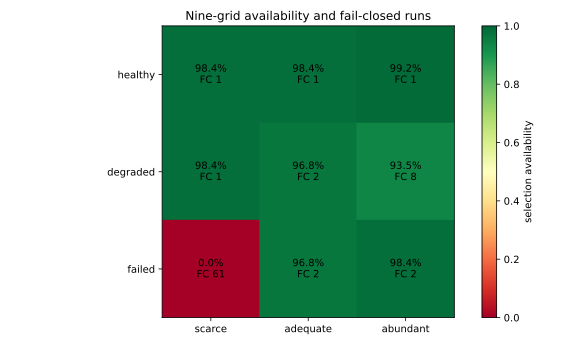

# Public Edge Manager

[简体中文](README.zh-CN.md)

[](https://github.com/public-edge/public-edge-manager/actions/workflows/ci.yml)
[](https://github.com/public-edge/public-edge-manager/actions/workflows/security.yml)
[](https://securityscorecards.dev/viewer/?uri=github.com/public-edge/public-edge-manager)
[](LICENSE)

Public Edge Manager is an open-source Kubernetes controller and authoritative
DNS service for choosing which public ingress edge should serve a request.

Kubernetes can expose workloads, but it does not decide which regional edge is
currently reachable, has capacity, and is healthy from the application's point
of view. Public Edge Manager turns live Kubernetes, Gateway, network-path and
application-probe evidence into deterministic DNS answers and auditable
`PublicEdge` status.

It is application- and DNS-provider-agnostic. It does **not** configure routers,
NAT, BGP, certificates or application routes; those remain owned by their
existing controllers and operators.

## What it provides

- Discovers public-edge candidates from Kubernetes facts instead of a private
  inventory embedded in the product.
- Excludes stale, unreachable or unready candidates before publication.
- Selects healthy edges by client locality, declared capacity and priority.
- Serves delegated authoritative DNS over UDP and TCP.
- Preserves a last-known-good edge through short probe failures and applies
  controlled failover timing.
- Publishes signed container images, an OCI Helm chart and a signed release
  manifest containing immutable artifact digests.

## Quick start

Public Edge Manager is intended for operators who already have Kubernetes
Nodes, a programmed Gateway and public DNS delegation. Start with the example
values, replace every documentation address and domain, and install the chart:

```sh
cp examples/values-example.yaml values-production.yaml
# Edit values-production.yaml for your delegated zone, nameservers and services.

helm install public-edge-manager \
  oci://ghcr.io/public-edge/charts/public-edge-manager \
  --version 0.8.13 \
  --namespace public-edge-system --create-namespace \
  --values values-production.yaml
```

The chart defaults to `enabled: false`; installation does not publish an edge
until the required service directory, nameserver fallback and readiness
evidence are configured.

Inspect the derived state from the least-privilege CLI pod:

```sh
kubectl -n public-edge-system exec deploy/public-edge-manager-cli -- \
  edgectl status
```

Register a service, then inspect the result:

```sh
kubectl -n public-edge-system exec deploy/public-edge-manager-cli -- \
  edgectl service-register app.example.com \
  --service app --class web --probe-path /healthz \
  --accepted-statuses 200,401

kubectl -n public-edge-system exec deploy/public-edge-manager-cli -- \
  edgectl status
```

See the [CLI guide](docs/CLI.md) for every command and a safe operator
walkthrough.

## Components it works with

Public Edge Manager uses Kubernetes and Gateway API as its runtime sources of
truth and serves authoritative DNS itself. Optional integrations provide
network evidence, external measurements, or DNS-provider publication:

- **ExternalDNS + PowerDNS**: Public Edge Manager selects the target and updates
  a dedicated Ingress annotation; ExternalDNS performs the RFC 2136 write to
  PowerDNS. Public Edge Manager never stores the PowerDNS credential.
- **Globalping**: supplies bounded external DNS, HTTP, and edge-quality
  observations; it is observe-only by default.
- **NetworkPathAssessment producer**: supplies provider-neutral path evidence.
- **Cloudflare**: optional parent-delegation reconciliation.
- **RouterOS or another independent authority**: optional secondary authority
  qualified through public UDP and TCP probes.

These integrations are not all required. Read the
[dependency and responsibility map](docs/DEPENDENCIES.md) before choosing a
deployment shape.

Explicit `routingPolicy.regions` order takes precedence over measurement scores.
A healthy fallback returns to a recovered preferred entry only after the
configured candidate ready and hold windows. Score changes alone keep a healthy
selection stable when there is no stronger explicit policy preference.

## Scenario simulation

The [multi-node simulation study](research/MULTI_NODE_SIMULATION.md) executes the
production scoring function across a deterministic network/resource nine-grid.
It publishes candidate-level CSV data, five text-only SVG figures, an English
article and a [complete Chinese translation](research/MULTI_NODE_SIMULATION.zh-CN.md).



Reproduce every table and chart without contacting a cluster:

```sh
python -m pip install --require-hashes -r requirements-research.lock
PYTHONPATH=src python research/generate.py
git diff --exit-code -- research
```

The shorter [scenario matrix](docs/SCENARIO-MATRIX.md) remains the operator
overview. The study is a deterministic policy-model analysis, not an Internet
performance benchmark or a representation of production traffic.

## Documentation

Detailed documentation lives in the
[project Wiki](https://github.com/public-edge/public-edge-manager/wiki):

- [Architecture and decision model](https://github.com/public-edge/public-edge-manager/wiki/Architecture-and-decision-model)
- [Installation and configuration](https://github.com/public-edge/public-edge-manager/wiki/Installation-and-configuration)
- [Operations and security](https://github.com/public-edge/public-edge-manager/wiki/Operations-and-security)
- [Releases and artifact verification](https://github.com/public-edge/public-edge-manager/wiki/Releases-and-artifact-verification)

The machine-readable list of everything this repository publishes is
[`artifacts.json`](artifacts.json). See
[GitHub Releases](https://github.com/public-edge/public-edge-manager/releases)
for signed release manifests and immutable package identities.

## Project links

- [Supply chain and multi-node simulation project](https://github.com/orgs/public-edge/projects/1)
- [Helm and container packages](https://github.com/orgs/public-edge/packages)
- [Issues](https://github.com/public-edge/public-edge-manager/issues)
- [Contributing](CONTRIBUTING.md)
- [Security policy and private reporting](SECURITY.md)
- [Apache-2.0 license](LICENSE)

### Explicit AmongCluster public-ingress references (opt-in)

Existing federated declarations remain compatible. To consume a reviewed
`ServiceAdvertisement.publicIngress` dynamically, set both exact references in
`PublicEdge.spec.discovery`, alongside `source: AmongCluster`, `clusterRef`
(the publisher), `serviceRef` (the exact SPIFFE service identity), and `protocol`:

```yaml
advertisementRef: {namespace: peering, name: canary, uid: ad-object-uid}
importedServiceRef: {namespace: peering, name: canary-import, uid: import-object-uid}
```

Grant read-only access only to reviewed namespaces through
`federation.readableNamespaces: [peering]`. No cross-namespace list or write access
is added. The consumer validates object UIDs, publisher/identity/protocol,
publication TTL, revocation, targeted peer and the import's observed revision.
It never turns an AmongCluster QUIC gateway endpoint into an HTTPS endpoint.

A valid typed `publicIngress` updates candidate address, TLS SNI, port and probe
path. Only the matching service hostname is exposed. Changed endpoints clear
old health; an in-flight response for an earlier endpoint revision cannot qualify
the replacement. Revocation, expiry, missing references and stale import state
reject eligibility without the normal transport-failure DNS grace period.
The same holds when a bound candidate is removed. A control-plane outage cannot
extend the cached advertisement's explicit expiry.

Explicitly bound candidates must pass fresh Service AF NPA evidence, even when
compatibility mode is Optional, Shadow or Disabled. Add an explicit
`discovery.assessmentRef` with `{name, uid, sourceNode, targetId, paddingBytes}`,
or `assessmentRefs` keyed by authority source-node name. Only the current
`NODE_NAME` reference is consumed; a single reference must name that same node.
The subject must match the advertised Service identity and the full scope must
match endpoint, port, TLS SNI, path and expected size array (including >=2048-byte
padding). Both host/pod transfer completeness and latency-budget evidence must be
fresh and successful. Node readiness alone never substitutes for that evidence.
No missing-source fallback or cross-node borrowing is allowed. An optional
`expectedConfigurationDigest` on each assessment reference strictly binds the
producer-owned `scope.targetConfigurationDigest`; the consumer records the full
scope and does not duplicate the producer's digest algorithm.

Controlled acceptance uses an isolated hostname: keep endpoint A healthy while
advertising B, prove B is independently probed, then revoke or expire the source
while HTTP stays healthy and verify authoritative DNS removes it. Record source
and import revisions, NPA provenance, endpoint revision and DNS answer/TTL. This
contract does not claim that legacy declarations already follow advertisement
changes; migrate their references through a reviewed GitOps change.
