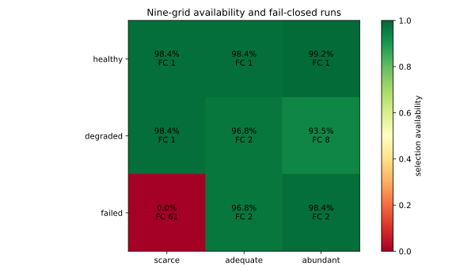

# Public Edge Manager

[English](README.md)

Public Edge Manager 是一个开源的 Kubernetes 控制器和权威 DNS 服务，用于决定当前应由哪个公共入口边缘承载请求。

Kubernetes 能够暴露工作负载，但不会判断某个区域边缘当前是否可从公网到达、是否有足够容量，以及应用探针是否健康。Public Edge Manager 将 Kubernetes Node、Gateway、网络路径和应用探针证据转化为确定性的 DNS 应答和可审计的 `PublicEdge` 状态。

它不配置路由器、NAT、BGP、证书或应用路由；这些仍由已有控制器和运维系统负责。

## 它解决什么问题

- 从 Kubernetes 事实发现边缘候选，而不是维护私有地址清单。
- 在发布前排除过期、不可达或未就绪的候选。
- 根据客户端区域、声明容量、优先级和延迟选择健康边缘。
- 通过 UDP 和 TCP 提供委派区域的权威 DNS。
- 在短暂探针故障时保留最后一次验证通过的边缘，并进行受控切换。
- 发布经过签名的容器镜像、OCI Helm Chart 和不可变发布清单。

## 五分钟开始使用

前提条件：已有 Kubernetes Node、状态为 Programmed 的 Gateway，以及可以委派的 DNS 区域。

```sh
cp examples/values-example.yaml values-production.yaml
# 将示例域名、地址、nameserver 和服务替换为自己的值。

helm install public-edge-manager \
  oci://ghcr.io/public-edge/charts/public-edge-manager \
  --version 0.8.6 \
  --namespace public-edge-system --create-namespace \
  --values values-production.yaml
```

Chart 默认 `enabled: false`。只有服务目录、nameserver 后备值和就绪证据准备完成后，才应启用公共发布。

查看控制器推导出的运行状态：

```sh
kubectl -n public-edge-system exec deploy/public-edge-manager-cli -- \
  edgectl status
```

登记一个需要自动选择边缘的服务：

```sh
kubectl -n public-edge-system exec deploy/public-edge-manager-cli -- \
  edgectl service-register app.example.com \
  --service app --class web --probe-path /healthz \
  --accepted-statuses 200,401
```

再次执行 `edgectl status`，确认 `runtime.services`、候选 `edges` 和 Gateway 地址符合预期。完整命令、修改模型参数和回滚方法见 [CLI 使用指南](docs/CLI.md)。

## 会借助哪些组件

必需或基础组件：

- **Kubernetes API**：Node、ConfigMap、Lease 和 `PublicEdge` 的运行时事实来源。
- **Gateway API**：提供已编程 Gateway 的标准状态和公共 VIP。
- **公共 DNS 委派**：将目标区域委派给 Public Edge Manager 的权威 DNS。

可选组件：

- **ExternalDNS + PowerDNS**：Public Edge Manager 只选择目标并写入专用 Ingress 注解；ExternalDNS 使用 RFC 2136 更新 PowerDNS。PowerDNS 凭据不进入 Public Edge Manager。
- **Globalping**：从外部探测 DNS、HTTP 和具体边缘地址；默认仅观察，不影响发布。
- **NetworkPathAssessment 提供方**：提供与网络实现无关的路径证据。
- **Cloudflare**：可选的父区域委派同步。
- **RouterOS 或其他独立权威 DNS**：作为经过 UDP/TCP 公网探针验证的辅助权威节点。
- **Flux**：推荐用于持久配置的 GitOps 调和，但不是运行时依赖。

详细责任边界见[依赖组件与责任图](docs/DEPENDENCIES.md)。

## 网络与资源九宫格

[`PublicEdge 多节点九宫格仿真研究`](research/MULTI_NODE_SIMULATION.zh-CN.md)
直接复用生产评分函数，发布候选级 CSV、五张文本型 SVG 图表，以及
[英文研究正文](research/MULTI_NODE_SIMULATION.md)。模型推演组合两类条件：

- 外部网络：正常、退化、故障；
- 手中资源：紧张、适中、充足。

[九宫格场景说明](docs/SCENARIO-MATRIX.md)给出运维摘要；完整研究提供每格的边界扫描、数据表和反例。



无需连接集群即可逐字节复现：

```sh
python -m pip install --require-hashes -r requirements-research.lock
PYTHONPATH=src python research/generate.py
git diff --exit-code -- research
```

这是确定性策略模型研究，不是互联网性能基准，也不代表生产流量。

## 文档与项目链接

- [供应链与多节点仿真 Project](https://github.com/orgs/public-edge/projects/1)
- [项目 Wiki](https://github.com/public-edge/public-edge-manager/wiki)
- [CLI 使用指南](docs/CLI.md)
- [依赖组件与责任图](docs/DEPENDENCIES.md)
- [网络与资源九宫格](docs/SCENARIO-MATRIX.md)
- [多节点仿真研究](research/MULTI_NODE_SIMULATION.zh-CN.md)
- [发布物登记](artifacts.json)
- [版本与签名发布物](https://github.com/public-edge/public-edge-manager/releases)
- [贡献指南](CONTRIBUTING.md)
- [安全策略](SECURITY.md)
- [Apache-2.0 许可证](LICENSE)
